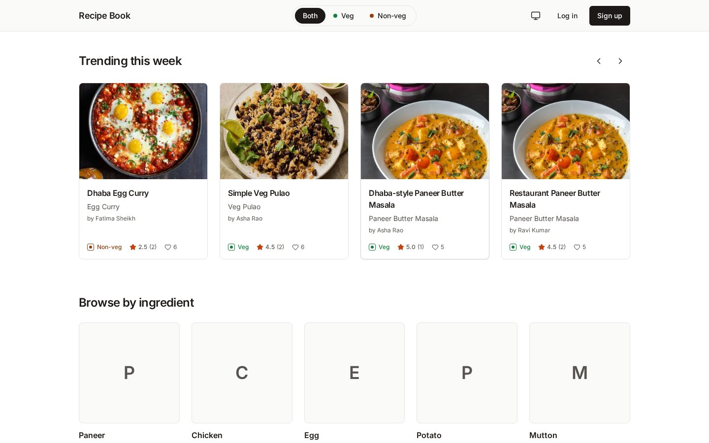
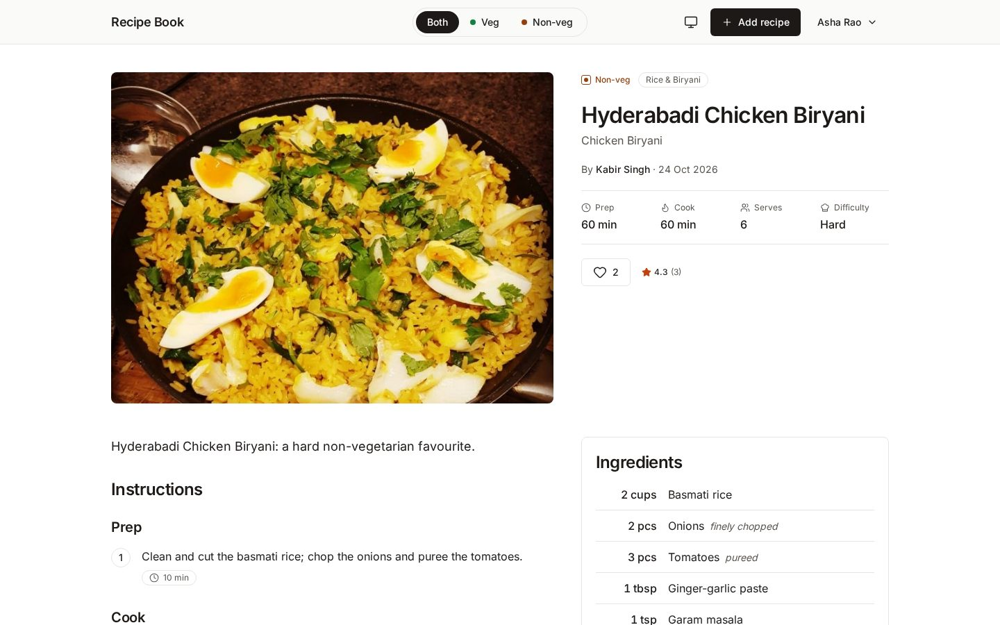
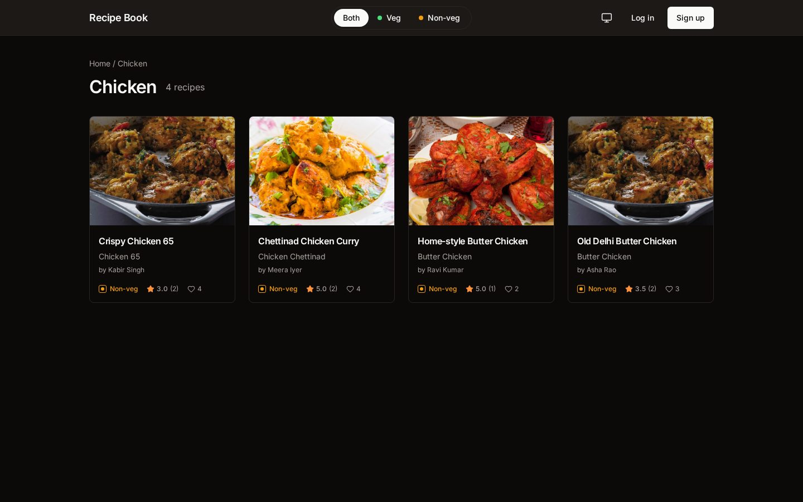
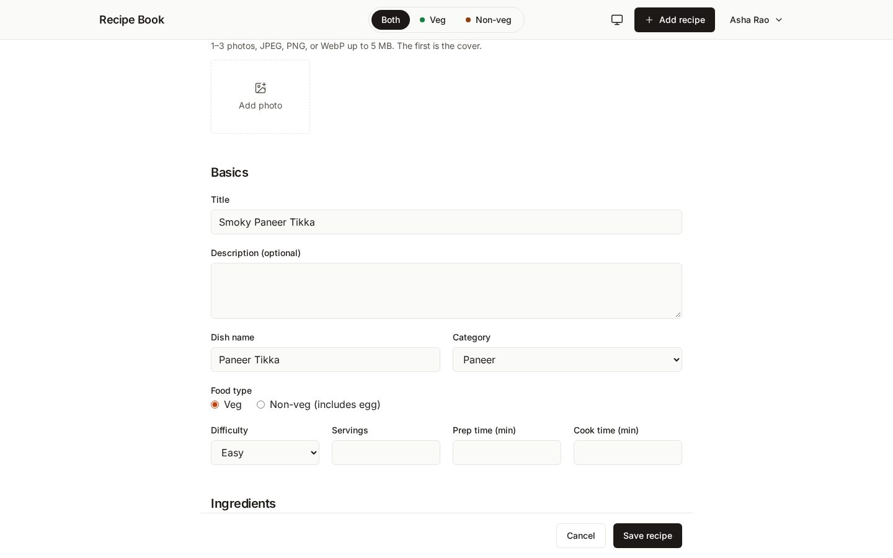
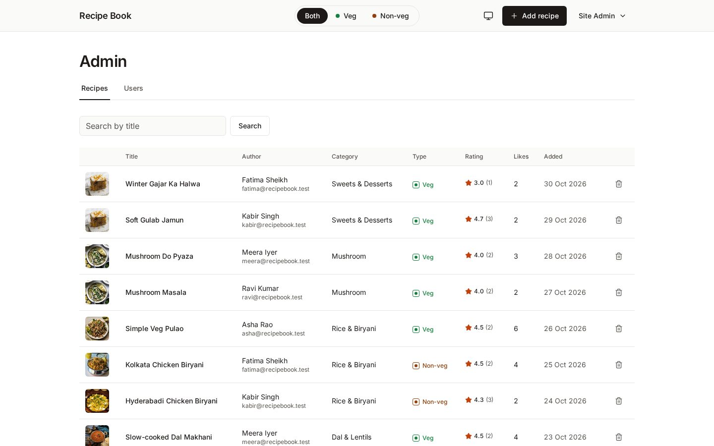

# Recipe Book

A multi-user recipe sharing app. People post recipes with photos and step-by-step instructions, browse everyone's recipes by main ingredient (Paneer, Chicken, Egg…), filter everything by **veg / non-veg**, save recipes to **Want to try**, and review them. An admin can see every user and delete any recipe or review.

It was built for a NoSQL assignment, to show MongoDB (embedded arrays, references with `$lookup`, aggregation pipelines, text and compound indexes, schema validation) running behind **two interchangeable backends**: Express + Mongoose and FastAPI + Beanie. They share one React frontend and one MongoDB, give identical responses, and read each other's documents.



| | |
|---|---|
|  |  |
|  |  |

## Quick start

Requires **Docker**, **Node.js 22**, and **Python 3.12**.

```bash
# 1. Database (MongoDB 7 in Docker), then schema, indexes, and the 10 categories (safe to re-run)
docker compose up -d
docker compose ps                                                    # wait for "healthy"
docker compose exec -T mongo mongosh recipebook /scripts/init-db.js

# 2. Config: one .env at the repo root, read by both backends
cp .env.example .env    # set JWT_SECRET (32+ characters) and your Cloudinary keys

# 3. Pick a backend, install it, load the demo data, and start it (it keeps running in this terminal)
cd backend-express && npm install && npm run seed && npm run dev            # API on :5000
#   or
cd backend-fastapi && python3.12 -m venv .venv && .venv/bin/pip install -r requirements.txt \
  && .venv/bin/python -m scripts.seed && .venv/bin/uvicorn app.main:app --reload --port 8000   # API on :8000

# 4. In a second terminal, from the repo root: the frontend, pointed at the backend you started
cd frontend && npm install && npm run dev:express    # or: npm run dev:fastapi
```

Open **http://localhost:5173**. The seeded accounts all use the password `password123`: `admin@recipebook.test` (admin), `asha@recipebook.test`, `ravi@recipebook.test`, `meera@recipebook.test`, `kabir@recipebook.test`, `fatima@recipebook.test`.

Notes:
- The app is **desktop only** (at least 1280 px wide) and has light, dark, and system themes.
- MongoDB listens on `mongodb://localhost:27017`, localhost only, with no password (local development only). MongoDB Compass connects to the same URL.
- On Docker Desktop for Linux, the project folder must be shared (Settings → Resources → File sharing), or the `./db:/scripts` mount is refused.
- Seed photos are hot-linked from [TheMealDB](https://www.themealdb.com), so the demo needs internet access to show them.
- Without Cloudinary keys everything still works except real photo uploads. Set `CLOUDINARY_FAKE=1` in `.env` to use fake image URLs instead.

## Switching backends

Both backends implement the same 21-endpoint API (`docs/TRD.md` §6), use the same `JWT_SECRET`, and store the same documents, so you can switch at any time:

1. Stop one backend and start the other (step 3 above).
2. Restart the frontend with the matching script: `npm run dev:express` (`http://localhost:5000/api/v1`) or `npm run dev:fastapi` (`http://localhost:8000/api/v1`).

Your login keeps working, because a token from either backend is valid on both. FastAPI also serves interactive API docs at `http://localhost:8000/docs`.

## Commands

| Where | Command | What |
|---|---|---|
| root | `docker compose up -d` / `down` / `down -v` | Start / stop / stop and **delete all data** |
| `backend-express/` | `npm run dev` · `npm start` | Express API on `:5000` ([README](backend-express/README.md)) |
| `backend-express/` | `npm run seed` (`-- --reset` to replace data) | Demo data: 6 users, 30 recipes, 100 likes, 50 reviews |
| `backend-express/` | `npm run create-admin -- <email> <password> [name]` | Make an admin (`/auth/register` never does) |
| `backend-fastapi/` | `.venv/bin/uvicorn app.main:app --reload --port 8000` | FastAPI on `:8000` ([README](backend-fastapi/README.md)) |
| `backend-fastapi/` | `.venv/bin/python -m scripts.seed` (`--reset`) | The same demo data as the Express seed |
| `backend-fastapi/` | `.venv/bin/python -m scripts.create_admin <email> <password> [name]` | Make an admin |
| `frontend/` | `npm run dev:express` · `npm run dev:fastapi` | React app on `:5173`, talking to that backend |
| `frontend/` | `npm run build` | Production build into `frontend/dist` |

## Testing

Every suite needs the Docker MongoDB running. The test suites use their own databases (`recipebook_test`, `recipebook_e2e`), so they never touch your demo data. **Run one suite at a time:** the contract suite and the backend unit tests share `recipebook_test` and fixed test ports, so overlapping runs interfere with each other.

| Suite | Command | What it covers |
|---|---|---|
| Contract (API) | `cd contract-tests && npm install && BACKEND=express npm test` (or `BACKEND=fastapi`) | 124 HTTP tests covering all 21 endpoints, written once and run against either backend. It starts the backend itself. This is the parity check: both backends must pass unchanged. |
| Express unit | `cd backend-express && npm test` | Validators, helpers, model serialisation, the image-cleanup rule, the `create-admin` script |
| FastAPI unit | `cd backend-fastapi && .venv/bin/python -m pytest` | Security (bcrypt / JWT parity with Express), schemas, error handling, rating rounding, image cleanup, the `create_admin` script |
| Frontend | `cd frontend && npm test` | 107 component tests: API client, auth / food-type / theme state, route guards, forms, like button, reviews, every page |
| End-to-end | `cd e2e && npm install && npx playwright install chromium && BACKEND=express npm test` (or `fastapi`) | Headless Chromium against a real backend: guest browsing, the veg toggle, and one recipe's full life (sign up, add with a photo, edit, another user likes and reviews it, an admin deletes it). It seeds with the *other* backend's script, so it also checks cross-reading. |

## What to show in a viva

| MongoDB feature | Where |
|---|---|
| Embedded arrays | `recipes.images`, `ingredients`, `instructions[].steps` (bounded, always read with the recipe) |
| References + `$lookup` | `reviews` and `likes` reference `recipes` and `users`; the trending, Want to try, category, and admin-user queries use `$lookup` |
| Aggregation pipelines | Category tiles with counts, trending this week, Want to try (`$facet` paging), rating recompute, users with recipe counts (`docs/DATABASE_SCHEMA.md` §6) |
| Text index | Search box: `$text` on `title` (weight 5) and `dishName` (weight 3) |
| Compound indexes | `{category, foodType, createdAt}`, `{foodType, createdAt}`, `{author, createdAt}`, `{user, createdAt}` on likes, … (§5) |
| Schema validation | A strict `$jsonSchema` on every collection, from `db/init-db.js` |
| Unique indexes as rules | One like and one review per user per recipe; unique email |

Try these in `docker compose exec mongo mongosh recipebook`:

```js
db.recipes.insertOne({ title: "x" })   // → Document failed validation
db.recipes.find({ category: "paneer", foodType: "veg" }).sort({ createdAt: -1 }).explain("executionStats").queryPlanner.winningPlan
//   → IXSCAN on recipes_category_foodType_createdAt
db.recipes.find({ foodType: { $in: ["veg", "nonveg"] } }).sort({ createdAt: -1 }).explain().queryPlanner.winningPlan
//   → SORT_MERGE of two IXSCANs: how "Both" uses an index (DATABASE_SCHEMA §6.2)
db.recipes.find({ $text: { $search: "biryani" } }).explain().queryPlanner.winningPlan       // → TEXT_MATCH / IXSCAN on recipes_text
db.likes.explain().aggregate([{ $match: { createdAt: { $gte: new Date(Date.now() - 7 * 864e5) } } }, { $group: { _id: "$recipe", n: { $sum: 1 } } }])
//   → IXSCAN on likes_createdAt (trending)
```

## Architecture

```
React (Vite) :5173 ──► /api/v1 ──► Express :5000  OR  FastAPI :8000 ──► MongoDB 7 (Docker)
                                         └──────── Cloudinary (images) ────────┘
```

```
db/init-db.js          collections, validators, indexes, categories (the only place indexes are made)
backend-express/       Express 5 + Mongoose 8: routes → controllers → services → models
backend-fastapi/       FastAPI + Beanie 2: routers → services → models, with Pydantic schemas
frontend/              React 19 + Vite + Tailwind 4 + React Router 7
contract-tests/        the shared API test suite
e2e/                   Playwright end-to-end tests
docs/                  PRD, TRD, database schema, UI/UX brief, decisions (ADRs), screenshots
tasks/                 the phase plan and checklist this was built from
```

| Decision | ADR |
|---|---|
| One frontend, two backends, one API contract | [0001](docs/decisions/0001-two-backends-one-contract.md) |
| `db/init-db.js` owns validators and indexes | [0002](docs/decisions/0002-init-script-owns-schema.md) |
| Document model: embed vs reference, stored counters, no transactions | [0003](docs/decisions/0003-document-model.md) |
| Shared HTTP contract test suite | [0004](docs/decisions/0004-shared-contract-test-suite.md) |
| Cloudinary with a test fake | [0005](docs/decisions/0005-cloudinary-with-test-fake.md) |
| JWT with a shared secret, role from the DB | [0006](docs/decisions/0006-jwt-shared-secret.md) |
| Desktop-only minimalist UI, CSS-variable tokens, dark mode | [0007](docs/decisions/0007-desktop-minimalist-ui.md) |
| FastAPI port: Beanie 2, camelCase aliases, plain ObjectId refs | [0008](docs/decisions/0008-beanie-port.md) |

Specs: [PRD](docs/PRD.md) · [TRD](docs/TRD.md) · [Database schema](docs/DATABASE_SCHEMA.md) · [UI/UX brief](docs/UI_UX_BRIEF.md) · [Changelog](CHANGELOG.md)

## Known limits

These are deliberate, each marked in the code with a `shortcut:` comment that names when to revisit it:

- **Orphaned uploads:** photos upload as soon as they're picked, so a removed photo or an abandoned form leaves its file in Cloudinary. The API contract has no delete-upload endpoint.
- **Upload type check** trusts the declared MIME type. Cloudinary rejects non-images on real uploads; sniff file contents if uploads ever go elsewhere.
- **Reviews** on the recipe page show the newest 50.
- **The form's category list** is a copy of the 10 categories in `db/init-db.js`, because `GET /categories` hides empty ones.
- **No transactions** (ADR-0003): a like plus its counter, and the delete cascade, are separate writes. A failed recipe delete can be retried.
- **Logout is client-side** (ADR-0006): a token stays valid until it expires (7 days).
