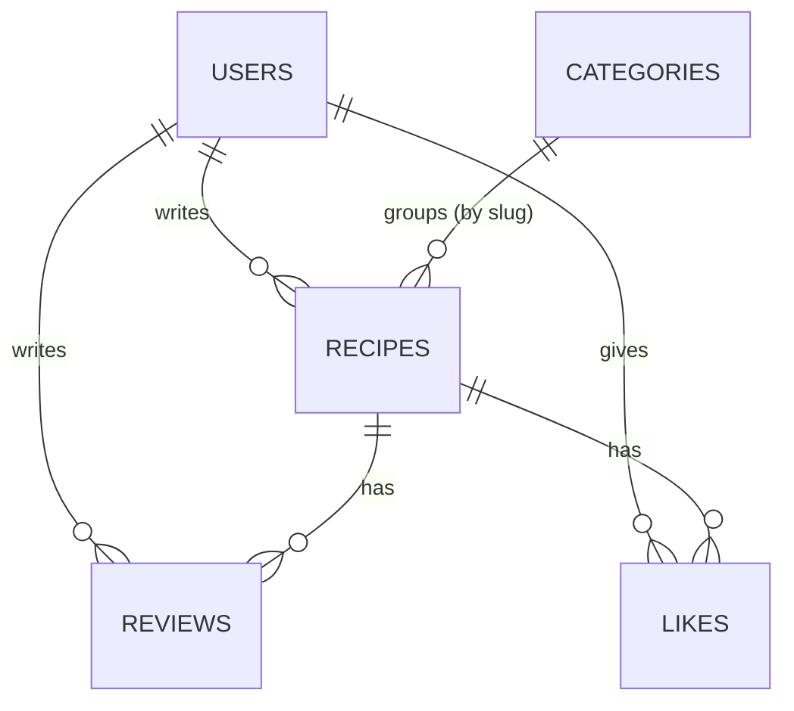

# Recipe Book — Database Schema

| | |
|---|---|
| **Database** | MongoDB 7 in Docker (`mongo:7`) |
| **Database name** | `recipebook` |
| **Connection** | `mongodb://localhost:27017/recipebook` |
| **Created by** | `db/init-db.js` (validators, indexes, categories) |
| **Status** | v2 (slimmed) — 31 Oct 2026 |

---

## 1. Overview

Five collections. A recipe is one rich document that embeds what's always shown with it (images, ingredients, instruction sections and steps). Reviews and likes can grow without limit, so they live in their own collections and point at the recipe.



| Collection | Holds | Embedded | References |
|---|---|---|---|
| `users` | Accounts and roles | — | — |
| `categories` | Main-ingredient tiles (Paneer, Chicken…) | — | — |
| `recipes` | One user's recipe | images, ingredients, instruction sections → steps | `author` → users, `category` → categories.slug |
| `reviews` | One rating + comment | — | `recipe` → recipes, `user` → users |
| `likes` | One user saving one recipe | — | `user` → users, `recipe` → recipes |

---

## 2. Conventions

- Field names are **camelCase**, identical whichever backend wrote the document.
- `_id` is an ObjectId; the API sends it as `id`.
- References are ObjectIds, except `recipes.category`, which stores the category's slug (`"paneer"`) so lists can filter without a lookup.
- Dates are BSON dates in UTC.
- Mongoose: `versionKey: false`, `_id: false` on embedded sub-schemas, `autoIndex: false`. Beanie: embedded objects are plain Pydantic models; no indexes declared.
- Every collection has a `$jsonSchema` validator (strict). The apps validate first; the validator is the safety net that keeps both backends honest.

---

## 3. Embed or reference?

| Data | Choice | Why |
|---|---|---|
| Ingredients, instruction sections, steps, images | Embed | Always shown with the recipe and limited in size (≤ 40 ingredients, ≤ 8 sections × 30 steps, ≤ 3 images) |
| Author | Reference | Name can change; one source of truth. Joined with `$lookup` or one batched `users.find` |
| Category | Reference by slug | Slug never changes, and lists filter on it directly |
| Reviews | Separate collection | A popular recipe could get thousands; embedding them would slow every recipe read and risk the 16 MB document limit |
| Likes | Separate collection | Unlimited, needs "one like per user per recipe", and needs timestamps for trending |

**Stored counters:** `avgRating`, `reviewCount`, and `likeCount` live on the recipe so cards don't need to count reviews and likes every time. Likes change them with `$inc`; reviews recompute them after each insert or delete (§6.4).

---

## 4. Collections

### 4.1 `users`

| Field | Type | Required | Rules |
|---|---|---|---|
| `name` | string | ✓ | 2–60 |
| `email` | string | ✓ | unique, lowercase |
| `passwordHash` | string | ✓ | bcrypt hash, never sent to the client |
| `role` | string | ✓ | `user` or `admin` |
| `createdAt` | date | ✓ | |

```json
{
  "_id": { "$oid": "6723a1f0c2a4b1e5d0a10001" },
  "name": "Nitin",
  "email": "nitin@example.com",
  "passwordHash": "$2b$12$Qm9yZW1pcHN1bWRvbG9yc2l0YW1ldGNvbnNlY3RldHVy",
  "role": "user",
  "createdAt": { "$date": "2026-10-31T05:30:00.000Z" }
}
```

### 4.2 `categories`

| Field | Type | Required | Rules |
|---|---|---|---|
| `slug` | string | ✓ | unique, lowercase-with-dashes |
| `name` | string | ✓ | display name |
| `imageUrl` | string or null | | tile image |
| `order` | number | ✓ | tile position |

```json
{ "_id": { "$oid": "6723a1f0c2a4b1e5d0a20001" }, "slug": "paneer", "name": "Paneer", "imageUrl": null, "order": 1 }
```

`init-db.js` creates 10: paneer, chicken, egg, potato, mutton, fish-seafood, dal-lentils, rice-biryani, mushroom, sweets-desserts. Categories have no veg/non-veg flag. Whether a tile shows under the toggle depends on whether it has matching recipes (§6.1).

### 4.3 `recipes`

| Field | Type | Required | Rules |
|---|---|---|---|
| `title` | string | ✓ | 3–120 |
| `description` | string or null | | ≤ 500 |
| `dishName` | string | ✓ | 2–80, e.g. "Paneer Butter Masala"; several users can share one |
| `author` | ObjectId | ✓ | → users |
| `foodType` | string | ✓ | `veg` or `nonveg` (egg = nonveg) |
| `category` | string | ✓ | a category slug |
| `difficulty` | string | ✓ | `easy`, `medium`, `hard` |
| `servings` | number | ✓ | 1–50 |
| `prepTimeMin`, `cookTimeMin` | number | ✓ | 0–1440 |
| `images` | array of `{ url, publicId }` | ✓ | 1–3, first is the cover |
| `ingredients` | array | ✓ | 1–40 × `{ name, quantity?, unit?, note? }` |
| `instructions` | array | ✓ | 1–8 × `{ section?, steps: [ { text, durationMin?, tip? } ] }` (1–30 steps each) |
| `avgRating` | number | ✓ | 0–5, starts at 0 |
| `reviewCount` | number | ✓ | starts at 0 |
| `likeCount` | number | ✓ | starts at 0 |
| `createdAt`, `updatedAt` | date | ✓ | |

```json
{
  "_id": { "$oid": "6723a1f0c2a4b1e5d0a30001" },
  "title": "Dhaba-style Paneer Butter Masala",
  "description": "Smoky, buttery paneer in a tomato-cashew gravy.",
  "dishName": "Paneer Butter Masala",
  "author": { "$oid": "6723a1f0c2a4b1e5d0a10001" },
  "foodType": "veg",
  "category": "paneer",
  "difficulty": "medium",
  "servings": 4,
  "prepTimeMin": 20,
  "cookTimeMin": 35,
  "images": [
    { "url": "https://res.cloudinary.com/demo/image/upload/v1/recipebook/pbm.jpg", "publicId": "recipebook/pbm" }
  ],
  "ingredients": [
    { "name": "Paneer", "quantity": 250, "unit": "g", "note": "1-inch cubes" },
    { "name": "Tomatoes", "quantity": 4, "unit": "pcs", "note": "roughly chopped" },
    { "name": "Cashews", "quantity": 12, "unit": "pcs", "note": "soaked 15 min" },
    { "name": "Butter", "quantity": 2, "unit": "tbsp", "note": null },
    { "name": "Kasuri methi", "quantity": 1, "unit": "tsp", "note": "crushed" }
  ],
  "instructions": [
    {
      "section": "Gravy",
      "steps": [
        { "text": "Heat 1 tbsp butter, add cashews and tomatoes, and cook until the tomatoes are mushy.", "durationMin": 8, "tip": "Don't rush this; raw tomato makes the gravy sour." },
        { "text": "Cool slightly and blend to a smooth paste.", "durationMin": 2, "tip": null }
      ]
    },
    {
      "section": "Finish",
      "steps": [
        { "text": "Simmer the paste with spices, add paneer, then finish with the remaining butter and kasuri methi.", "durationMin": 6, "tip": "Add paneer last so it stays soft." }
      ]
    }
  ],
  "avgRating": 4.5,
  "reviewCount": 12,
  "likeCount": 31,
  "createdAt": { "$date": "2026-10-28T09:12:00.000Z" },
  "updatedAt": { "$date": "2026-10-30T14:40:00.000Z" }
}
```

### 4.4 `reviews`

| Field | Type | Required | Rules |
|---|---|---|---|
| `recipe` | ObjectId | ✓ | → recipes |
| `user` | ObjectId | ✓ | → users; one review per user per recipe |
| `rating` | number | ✓ | whole number 1–5 |
| `comment` | string or null | | ≤ 1000 |
| `createdAt` | date | ✓ | |

```json
{ "_id": { "$oid": "6723a1f0c2a4b1e5d0a40001" },
  "recipe": { "$oid": "6723a1f0c2a4b1e5d0a30001" }, "user": { "$oid": "6723a1f0c2a4b1e5d0a10002" },
  "rating": 5, "comment": "Perfect gravy, kids loved it.", "createdAt": { "$date": "2026-10-31T04:10:00.000Z" } }
```

### 4.5 `likes`

| Field | Type | Required | Rules |
|---|---|---|---|
| `user` | ObjectId | ✓ | one like per user per recipe |
| `recipe` | ObjectId | ✓ | |
| `createdAt` | date | ✓ | used for trending and Want to try order |

```json
{ "_id": { "$oid": "6723a1f0c2a4b1e5d0a50001" }, "user": { "$oid": "6723a1f0c2a4b1e5d0a10002" },
  "recipe": { "$oid": "6723a1f0c2a4b1e5d0a30001" }, "createdAt": { "$date": "2026-10-31T03:55:00.000Z" } }
```

---

## 5. Indexes

| Collection | Name | Keys | Used by |
|---|---|---|---|
| users | `users_email_unique` | `{ email: 1 }` unique | Login; duplicate signup → 409 |
| categories | `categories_slug_unique` | `{ slug: 1 }` unique | Category lookups |
| recipes | `recipes_text` | text on `title` (weight 5), `dishName` (3) | Search box |
| recipes | `recipes_category_foodType_createdAt` | `{ category: 1, foodType: 1, createdAt: -1 }` | Category page, tile counts |
| recipes | `recipes_foodType_createdAt` | `{ foodType: 1, createdAt: -1 }` | Latest recipes on Home |
| recipes | `recipes_author_createdAt` | `{ author: 1, createdAt: -1 }` | My recipes, admin per-user view |
| reviews | `reviews_recipe_user_unique` | `{ recipe: 1, user: 1 }` unique | One review per user; reviews on a recipe; delete cascade |
| reviews | `reviews_recipe_createdAt` | `{ recipe: 1, createdAt: -1 }` | Review list, newest first |
| likes | `likes_user_recipe_unique` | `{ user: 1, recipe: 1 }` unique | One like per user; `likedByMe` |
| likes | `likes_user_createdAt` | `{ user: 1, createdAt: -1 }` | Want to try list |
| likes | `likes_recipe` | `{ recipe: 1 }` | Delete cascade |
| likes | `likes_createdAt` | `{ createdAt: -1 }` | Trending this week |

Check one in the viva: `db.recipes.find({ category: "paneer", foodType: "veg" }).sort({ createdAt: -1 }).explain("executionStats")` → the winning plan should show `IXSCAN` on `recipes_category_foodType_createdAt`.

---

## 6. Main queries

`foodTypeFilter` = `{ foodType: "veg" }`, `{ foodType: "nonveg" }`, or `{}` for Both.

### 6.1 Category tiles with counts (`GET /categories`)

```js
// on recipes
[
  { $match: { ...foodTypeFilter } },
  { $group: { _id: "$category", recipeCount: { $sum: 1 } } },
  { $lookup: { from: "categories", localField: "_id", foreignField: "slug", as: "c" } },
  { $unwind: "$c" },
  { $project: { _id: 0, slug: "$c.slug", name: "$c.name", imageUrl: "$c.imageUrl", order: "$c.order", recipeCount: 1 } },
  { $sort: { order: 1 } }
]
```

Categories with no matching recipes produce no group, so they disappear under the toggle on their own.

### 6.2 Recipe lists (`GET /recipes`, category page, latest, search)

```js
db.recipes.find(
  { ...foodTypeFilter, category: "paneer" /* optional */, dishName: /^paneer butter masala$/i /* optional */ },
  { title: 1, dishName: 1, images: { $slice: 1 }, foodType: 1, category: 1,
    avgRating: 1, reviewCount: 1, likeCount: 1, author: 1, createdAt: 1 }
).sort({ createdAt: -1 }).skip((page - 1) * limit).limit(limit)
```

- **Both** (no `foodType` param) is sent as `foodType: { $in: ["veg", "nonveg"] }`, not left out. Without a `foodType` condition, no index can serve the `createdAt` sort, so MongoDB scans the whole collection and sorts in memory. With `$in`, it merges two index scans in order (`SORT_MERGE`).
- Search adds `$text: { $search: q }` and sorts by `{ score: { $meta: "textScore" } }`.
- Author names: collect the `author` ids on the page and run one `db.users.find({ _id: { $in: ids } }, { name: 1 })`.
- The dish filter regex is built from the escaped, trimmed `dish` param.

### 6.3 Trending this week (`GET /recipes/trending`)

```js
// on likes. since = now minus 7 days
[
  { $match: { createdAt: { $gte: since } } },
  { $group: { _id: "$recipe", weekLikes: { $sum: 1 } } },
  { $sort: { weekLikes: -1 } },
  { $limit: 30 },
  { $lookup: { from: "recipes", localField: "_id", foreignField: "_id", as: "recipe" } },
  { $unwind: "$recipe" },
  { $match: { /* "recipe.foodType": "veg" when the toggle is set */ } },
  { $limit: 10 }
]
```

It takes 30 before the lookup and 10 after, so filtering by food type doesn't leave the list short.

### 6.4 Rating after a review is added or deleted

```js
const [s] = await db.reviews.aggregate([
  { $match: { recipe: recipeId } },
  { $group: { _id: null, avg: { $avg: "$rating" }, n: { $sum: 1 } } }
]).toArray();

db.recipes.updateOne({ _id: recipeId }, {
  $set: { avgRating: s ? Math.round(s.avg * 10) / 10 : 0, reviewCount: s ? s.n : 0 }
});
```

### 6.5 Like and unlike

```js
// like: the unique index stops double likes
try {
  db.likes.insertOne({ user, recipe, createdAt: new Date() });
  db.recipes.updateOne({ _id: recipe }, { $inc: { likeCount: 1 } });
} catch (e) { /* code 11000 = already liked, do nothing */ }

// unlike
const r = db.likes.deleteOne({ user, recipe });
if (r.deletedCount === 1) db.recipes.updateOne({ _id: recipe }, { $inc: { likeCount: -1 } });
```

### 6.6 Want to try (`GET /me/likes`)

```js
// on likes
[
  { $match: { user: userId } },
  { $sort: { createdAt: -1 } },
  { $lookup: { from: "recipes", localField: "recipe", foreignField: "_id", as: "r" } },
  { $unwind: "$r" },
  { $match: { /* "r.foodType": "veg" when the toggle is set */ } },
  { $facet: {
      items: [ { $skip: skip }, { $limit: limit }, { $replaceWith: "$r" } ],
      total: [ { $count: "n" } ] } }
]
```

### 6.7 Admin users with recipe counts (`GET /admin/users`)

```js
// on users
[
  { $sort: { createdAt: -1 } }, { $skip: skip }, { $limit: limit },
  { $lookup: { from: "recipes", localField: "_id", foreignField: "author", as: "recipes" } },
  { $project: { name: 1, email: 1, role: 1, createdAt: 1, recipeCount: { $size: "$recipes" } } }
]
```

### 6.8 Deleting a recipe (owner or admin)

```js
db.reviews.deleteMany({ recipe: id });
db.likes.deleteMany({ recipe: id });
db.recipes.deleteOne({ _id: id });
// then delete each images[].publicId from Cloudinary
```

---

## 7. Setup and maintenance

```bash
docker compose up -d
docker compose exec mongo mongosh recipebook /scripts/init-db.js
```

- **Check the validator:** in mongosh, `db.recipes.insertOne({ title: "x" })` must fail with "Document failed validation".
- **Seed data** (backend script): about 6 users and 30 recipes across categories, both veg and non-veg, with a few dishes posted by 2–3 different users. Add about 100 likes spread over the last two weeks and about 50 reviews, then set the counters with the same helpers the API uses.
- **Backup:** `docker compose exec mongo mongodump --db recipebook --archive > backup.archive`
- **Restore:** `docker compose exec -T mongo mongorestore --archive < backup.archive`
- **Reset everything:** `docker compose down -v`, then the two setup commands.
